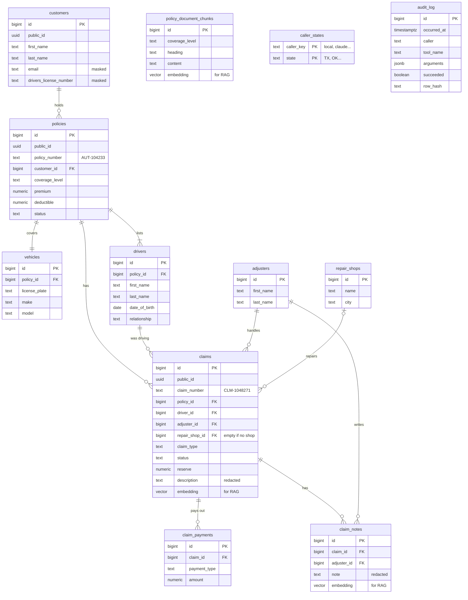

# Guide 1: the database

By the end of this guide you'll have PostgreSQL running in Docker on your own machine, locked down so the MCP server can only read through a fixed set of functions, and filled with fake data for a fictional auto insurer: about 12,000 customers, 15,000 policies and 15,000 claims.

Everything here is free, and the commands are the same on Windows, macOS and Linux.

## What you need

- **Docker:** [Docker Desktop](https://www.docker.com/products/docker-desktop/) on Windows or macOS, or Docker Engine on Linux. It runs PostgreSQL, so you don't install PostgreSQL itself.
- **uv:** [installing uv](https://docs.astral.sh/uv/getting-started/installation/). uv installs the right Python version (3.14) for you, so you don't need to install Python yourself.
- **Git**, to get the code.

## 1. Get the code

```bash
git clone https://github.com/Code-Express-AI/insurance-mcp-python.git
cd insurance-mcp-python
uv sync
```

`uv sync` downloads Python 3.14 if you don't have it, and installs the project's packages into a `.venv` folder inside the project.

## 2. Create your `.env` file

All settings and passwords live in one file, `.env`, which is git-ignored so it never gets committed. Start from the example:

```bash
cp .env.example .env
```

On Windows (Command Prompt), use `copy .env.example .env`.

Now replace the two example passwords with strong ones. This prints a random 32-character password:

```bash
uv run python -c "import secrets; print(secrets.token_urlsafe(24))"
```

Run it twice, once for each password. It only uses letters, digits, `-` and `_`, so the password can go straight into a connection string without any escaping.

### The database settings

| Setting | What it's for | Read by |
|---|---|---|
| `POSTGRES_PASSWORD` | The password of `postgres`, the admin role in the Docker database | Docker, the first time it creates the database |
| `ADMIN_DATABASE_URL` | How the setup command and the data generator connect: as `postgres`, with full rights | The setup command and the data generator, never the MCP server |
| `READER_DATABASE_URL` | How the MCP server connects: as `mcp_reader`, which can only run the `mcp` functions | The MCP server, and the setup command, which sets this password on `mcp_reader` |

Two things must match:

- **The password in `ADMIN_DATABASE_URL` must be the same as `POSTGRES_PASSWORD`.** Paste the first password you made into both places.
- **The `mcp_reader` password is written only in `READER_DATABASE_URL`.** The setup command takes it from there and sets it on the role, so there's no second copy to keep in step. It must be at least 24 characters.

The other settings in `.env` are for the MCP server. Guide 2 explains them.

## 3. Start PostgreSQL

```bash
docker compose up -d
```

The first time, Docker downloads the PostgreSQL image (a few hundred MB), then creates the database and stores it in a Docker volume, so it survives restarts. Check that it's running:

```bash
docker compose ps
```

The `STATUS` column should say `healthy` after a few seconds.

The database only listens on `127.0.0.1`, so other machines on your network can't reach it.

## 4. Build the database and load the data

```bash
uv run python -m insurance_mcp.setup_db
```

You should see:

```text
Running 01_roles.sql
Running 02_schema.sql
Running 03_permissions.sql
Running 04_functions.sql
Running 05_audit.sql
Loaded full data: 12,002 customers, 14,930 policies, 15,090 claims, 76,630 claim notes.
Database ready.
```

It takes a few seconds. In one transaction, so either all of it happens or none of it does, it:

1. Runs the SQL files in [`sql/`](../../sql/) in order: the roles, the tables, the permissions, the functions and the audit log.
2. Sets the `mcp_reader` password from `READER_DATABASE_URL`.
3. Generates the fake data and loads it.

It drops and rebuilds everything each time, so you can run it again whenever you want to start over.

## 5. Look around

Open `psql`, PostgreSQL's command-line client, inside the container as the admin role:

```bash
docker compose exec db psql -U postgres -d insurance
```

Try a few queries:

```sql
select state, count(*) from insurance.customers group by state order by count(*) desc;

select claim_number, claim_type, status, reserve, description
from insurance.claims
order by date_reported desc
limit 5;
```

Type `\q` to leave.

Now connect as `mcp_reader`, the role the MCP server uses, and try to read a table directly:

```bash
docker compose exec db psql -U mcp_reader -d insurance
```

```sql
select * from insurance.claims;         -- ERROR: permission denied for schema insurance
delete from insurance.claims;           -- ERROR: permission denied for schema insurance
select * from mcp.get_dataset_info();   -- works, but every count is 0
```

`mcp_reader` can run the functions it's been granted, one by one, and nothing else. That's the database's layer of security. [database-spec.md](../specs/database-spec.md) explains how it works.

**Why are the counts 0?** Because the database doesn't know who's asking. Each caller sees only the customers in its own states (row-level security), and a caller it doesn't know sees nothing. Tell it you're `local`, the token you'll make in guide 2, which sees every state, and ask again:

```sql
select set_config('mcp.caller_key', 'local', false);
select * from mcp.get_dataset_info();   -- now: 12,002 customers
```

The MCP server does the same before every call, with the name of the token that made the request. [Row-level security, step by step](#row-level-security-step-by-step) below shows the rest.

**Why no password?** Inside the container, the PostgreSQL image trusts connections made on the container itself, so `psql` doesn't ask. Connections from outside the container, like the MCP server's, always need the password.

## The tables

All the tables are in the `insurance` schema. Only the main columns are shown here:



- **Masked** columns are never returned in full: the functions show only part of an email (`m***@example.com`) and the last four characters of a driver's license number.
- **Redacted** text has any phone numbers and email addresses in it replaced with `[phone]` and `[email]` before it's returned. Adjusters sometimes type them into a note. The customer's own street address becomes `[address]`: the database knows whose claim it is, so it can look for that exact address. Names, and any other address, can't be caught this way.
- **`id` never leaves the database.** The tables join on the `bigint` ids, but the functions return `public_id` UUIDs or business numbers (`AUT-…`, `CLM-…`) instead. A sequential id would give away how many rows there are, and let a caller guess other records by counting.
- `policy_document_chunks` holds the three policy booklets, split into sections for RAG ([guide 4](04-rag.md)). It's linked to policies by `coverage_level`, not by a foreign key. The `embedding` columns stay empty until you run the embed command in that guide.
- `caller_states` lists which states each caller may see, for row-level security: see [Row-level security, step by step](#row-level-security-step-by-step) below. It's linked to customers by `state`, not by a foreign key.
- `audit_log` isn't linked to the other tables, because it records the tool calls, not the insurance data. Rows can be added but never changed or deleted, and a hash chain makes tampering detectable. [database-spec.md](../specs/database-spec.md) explains how.

## Row-level security, step by step

Each caller sees only the customers in its own states, along with their policies, claims and notes. Guides 1 to 3 use one token, `local`, which sees every state. At the end of guide 3 you'll give each client its own token, and each of those sees part of the data:

| Caller | States | Sees, but the other two don't |
|---|---|---|
| `local` | All five | |
| `claude` | TX, CO, OK | Oklahoma |
| `copilot` | TX, CO, NM | New Mexico |
| `inspector` | TX, CO, AZ | Arizona |

All three named callers see Texas and Colorado, where the demo customers live (Maria Garcia in Texas, Eleanor Rutherford in Colorado), so the demo questions work with any token.

In this walkthrough you play the part of the MCP server: you tell the database who's calling, then search for a customer.

**Step 1: as the admin, look at the mapping.** Row-level security doesn't filter the admin, so in the `postgres` connection from step 5 you can see every row:

```sql
select caller_key, string_agg(state, ', ' order by state) as states
from insurance.caller_states
group by caller_key
order by caller_key;
```

**Step 2: as `mcp_reader`, search as each caller.** Wei Kim lives in Oklahoma, so only `claude` (and `local`) can find them. In the `mcp_reader` connection, run these two lines together:

```sql
select set_config('mcp.caller_key', 'claude', false);
select first_name, last_name, city, state from mcp.find_customers('Wei Kim');   -- found
```

Now be `copilot` and search again:

```sql
select set_config('mcp.caller_key', 'copilot', false);
select first_name, last_name, city, state from mcp.find_customers('Wei Kim');   -- nothing
```

Try the others too. This is what you should see:

| Search for | `local` | `claude` | `copilot` | `inspector` |
|---|---|---|---|---|
| `Wei Kim` (Oklahoma) | Found | Found | Nothing | Nothing |
| `Mei Cruz` (New Mexico) | Found | Nothing | Found | Nothing |
| `Ana Cook` (Arizona) | Found | Nothing | Nothing | Found |
| `Maria Garcia` (Texas) | Found | Found | Found | Found |

- **"Nothing" is an empty result, not an error.** To a caller, a customer it can't see doesn't exist. Ask for one of their claims by number and you get "Unknown claim number", the same as for a number that doesn't exist.
- **A name the database doesn't know sees nothing at all.** Try `select set_config('mcp.caller_key', 'nobody', false);` and `get_dataset_info()` again.
- **How it works:** a policy on each of the seven tables that hold customer data adds a hidden condition to every query, so no function can forget the check. The rule is in [`06_row_security.sql`](../../sql/06_row_security.sql), and [database-spec.md](../specs/database-spec.md) (decision 15) explains it.

**The honest limit:** you just chose your own caller with one line. Anyone with the `mcp_reader` password can do the same, because PostgreSQL has no setting a session can't change. The MCP server sets the caller from the token, and no tool runs raw SQL, so a model can't change it. Keep the `mcp_reader` password as secret as the tokens.

## The data

All of it is fake. Nothing describes a real person, vehicle or company.

- **The same for everyone.** The generator uses a fixed random seed, so you get exactly the same customers, policies and claims as everyone else, and as these guides. Only the `public_id` UUIDs differ, and nothing relies on them.
- **"Today" is 31 December 2026.** The data covers 2024 to 2026, and never moves with the calendar. The MCP server tells the AI assistant to treat that date as today, so "last month" means November 2026.
- **Real places, fake people.** Cities, ZIP codes and area codes are real, in Texas, Oklahoma, Colorado, New Mexico and Arizona. Names, street addresses, license plates and driver's license numbers are made up. Every email is at `example.com`, and every phone number is in the `555-0100` to `555-0199` range, which is reserved for fiction.
- **Planted records.** A few records are added on purpose, so the demo questions have good answers: one customer called Rutherford with two policies, Maria Garcia with three claims, one repair shop that's clearly the most expensive. They're all listed at the top of [`planted.py`](../../src/insurance_mcp/generate/planted.py).

It's an insurance claims system kept deliberately small:

| Term | Meaning |
|---|---|
| Policy | The insurance on one vehicle. A customer with two cars has two policies. |
| Premium | What the customer pays for the policy, per year. |
| Deductible | The part of each claim the customer pays themselves. |
| Coverage level | `liability` (damage you cause to others), `liability_collision` (plus damage to your own car in a crash) or `full` (plus theft, fire, vandalism, weather and glass). |
| Claim | A request for the insurer to pay for a loss. |
| Reserve | What the insurer expects a claim to cost in total. |
| Adjuster | The insurer's employee who investigates and settles a claim. |

A few simplifications, so the data stays easy to follow:

- A policy runs from its start date until it's canceled or the data ends. Renewals aren't modeled.
- The policyholder is listed twice: once as a customer and once as a driver on each of their policies.
- Glass claims are windshield claims.
- Real US policies have per-state rules and more kinds of coverage. They're left out.

## Reload the data

The setup command loads the data, so you only need this to reload it:

```bash
uv run python -m insurance_mcp.generate
```

It empties the tables and loads everything again, in one transaction. It never touches the audit log.

Add `--size small` to either command for about 1/20 of the data, which loads in under a second. The tests use it. The guides and demos assume the full data.

## Run the tests

With Docker running:

```bash
uv run pytest
```

The tests start their own throwaway PostgreSQL container, build the database from scratch, load the small data, and delete the container at the end. They never touch your database. If Docker isn't running, the database tests are skipped with one message saying so.

A few checks only mean something on the full data, such as "one repair shop is clearly the most expensive". They're skipped by default. To run them:

```bash
uv run pytest -m full_data
```

## Start over

To delete the database completely, including the Docker volume it's stored in:

```bash
docker compose down -v
```

Then start again from step 3.

## Troubleshooting

**`no configuration file provided: not found`.** You're not in the project folder, so Docker can't find `docker-compose.yml`. Run `cd insurance-mcp-python`, then run the command again.

**`password authentication failed for user "postgres"`.** Docker only reads `POSTGRES_PASSWORD` the first time it creates the database. If you changed it afterwards, the database still has the old one. Either put the old password back, or delete the database with `docker compose down -v` and start again from step 3.

**`port is already allocated` or `address already in use`.** Something else on your machine, probably another PostgreSQL, is using port 5432. Stop it, or change the first `5432` under `ports:` in `docker-compose.yml` (for example to `127.0.0.1:5433:5432`) and use the same port in both connection strings in `.env`.

**`Setup stopped: The mcp_reader password in READER_DATABASE_URL must be at least 24 characters.`** Make a longer password with the command in step 2.

**`connection refused`.** The database isn't running. Start Docker, then run `docker compose up -d`.

## Next

[Guide 2](02-server.md) starts the MCP server and connects it to this database.
