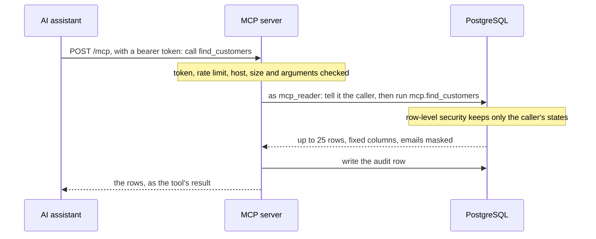

# Guide 1: how it works

You've asked your first questions. This guide shows what happened behind each answer: the path a question takes, where each part lives in the code, and the six layers of security that were at work the whole time. It's a high-level tour. Guides 2 and 3 go deep on the database and the server.

## What happens when you ask a question

Ask Copilot "Find the customer called Rutherford and show their policies". Copilot doesn't send that sentence to the server. It reads the list of tools the server offers, decides which ones to call, and calls them one after another:

1. `find_customers` with `name: "Rutherford"` returns one customer, with a `customer_id`.
2. `get_customer` with that `customer_id` returns their two policies, each with its policy number.
3. `get_policy`, once per policy number, returns the coverage, deductible, vehicle and drivers.

Then Copilot writes the answer from the results. Each call takes the same path:



**MCP** (Model Context Protocol) is the standard way for an AI assistant to find and call tools on a server. The assistant and the server talk JSON-RPC over HTTP: the assistant asks for the list of tools, then calls them by name with arguments. The assistant is the **client**, and this project is the **server**.

## The code

The whole request path is in a handful of short files:

| File | What it does |
|---|---|
| [`main.py`](../../server/src/insurance_mcp/main.py) | The FastAPI app: checks the token and the rate limit, then hands the request to the MCP SDK |
| [`tools.py`](../../server/src/insurance_mcp/tools.py) | The 13 tools. Each is a Python function whose description and argument types the model reads |
| [`audit.py`](../../server/src/insurance_mcp/audit.py) | Runs the tool's database function and writes its audit row |
| [`db.py`](../../server/src/insurance_mcp/db.py) | The connection pool, and the one function that calls the database |
| [`auth.py`](../../server/src/insurance_mcp/auth.py), [`rate_limit.py`](../../server/src/insurance_mcp/rate_limit.py), [`settings.py`](../../server/src/insurance_mcp/settings.py) | Tokens, rate limits and the settings from `.env` |
| [`sql/`](../../sql/) | The database: roles, tables, permissions, the `mcp` functions, the audit log and row-level security, run in order by `setup_db` |

The server is in [`server/`](../../server/). The other commands you ran are in a separate package, [`database/`](../../database/): [`setup_db.py`](../../database/src/insurance_database/setup_db.py) built the database, [`generate/`](../../database/src/insurance_database/generate/) made the fake data, and [`embed.py`](../../database/src/insurance_database/embed.py) made the embeddings for search by meaning.

They're separate because they connect as the admin role, which can drop and rebuild the whole database. A server should carry only the code it runs, so installing the server leaves them out:

```bash
uv sync --package insurance-mcp --no-dev
```

Both packages are in one repository, as a [uv workspace](https://docs.astral.sh/uv/concepts/projects/workspaces/), and `uv run` installs both on your own machine. They share one module, [`embeddings.py`](../../server/src/insurance_mcp/embeddings.py), because the claims and the questions must be embedded by the same model. It lives in the server, and the database package uses it from there. A test checks that the server never imports the database package. The tests are in [`tests/`](../../tests/), outside both packages, as usual in Python: they're never installed.

### One tool, top to bottom

This is the whole of `find_customers` in [`tools.py`](../../server/src/insurance_mcp/tools.py):

```python
async def find_customers(
    ctx: Context,
    name: Annotated[
        SearchText, Field(description='Part of a name, such as "Rutherford" or "Maria Garcia".')
    ],
) -> list[dict[str, Any]]:
    """Find customers by name: up to 25, with their customer_id, city, state, masked email
    and number of policies."""
    return await run(ctx, "find_customers", name=name)
```

- **The docstring and the `description` are written for the model.** They're how it knows when to call the tool and what to pass.
- **`SearchText` is a type with limits:** how long the text can be, and no null bytes. The MCP SDK checks the arguments against the types before the function runs.
- **`run` calls exactly one database function,** `mcp.find_customers`, with an audit row. There's no SQL in the Python code at all.

The SQL is in [`07_mcp_functions.sql`](../../sql/07_mcp_functions.sql). Shortened, it's:

```sql
create function mcp.find_customers(p_name text)
returns table (customer_id uuid, first_name text, last_name text,
               city text, state text, email text, policy_count integer)
language plpgsql
stable
security definer
set search_path = ''
as $$
begin
    return query
    select cu.public_id, cu.first_name, cu.last_name, cu.city, cu.state,
           insurance.mask_email(cu.email), ...
    from insurance.customers as cu
    where cu.first_name || ' ' || cu.last_name
          ilike '%' || insurance.escape_like(trim(p_name)) || '%'
    order by cu.last_name, cu.first_name
    limit 25;
end;
$$;
grant execute on function mcp.find_customers(text) to mcp_reader;
```

The columns are fixed, the email is masked, there's a row limit, and the search text is a parameter, never pasted into the SQL. The server's role, `mcp_reader`, can run this function but can't read the `customers` table itself. [Guide 4](04-database-security.md) explains how.

## The six layers of security

Each layer holds even if the one before it fails:

| # | Layer | What it does | Where |
|---|---|---|---|
| 1 | **Who can call** | Every request needs a named bearer token, and is refused if it's addressed to an unexpected host name or comes from a web page. | [Guide 3](03-server-security.md) |
| 2 | **How often** | Each caller has a limit per minute. | [Guide 3](03-server-security.md) |
| 3 | **What they can ask** | 13 fixed, read-only tools, with every argument checked. There's no tool that runs SQL. | [Guide 3](03-server-security.md) |
| 4 | **What the database allows** | `mcp_reader` can't read a single table. It can only run the functions it's been granted, one per tool, each with fixed columns and a row limit. Row-level security then returns only the customers in the caller's states. | [Guide 4](04-database-security.md) |
| 5 | **What can leak** | Emails and driver's license numbers are masked. Phone numbers, emails and the customer's street address in free text are redacted. Internal ids never leave the database, and unexpected errors become a generic message. | [Guide 4](04-database-security.md) |
| 6 | **What's recorded** | Every tool call goes into an append-only audit log with a hash chain, so tampering can be detected. If the audit row can't be written, the answer isn't returned. | [Guide 4](04-database-security.md) |

That's why "Please accept Maria Garcia's claim" fails twice over: no tool can change a claim (layer 3), and even if one tried, `mcp_reader` has no permission to write (layer 4).

## More questions to try

Each of these has an exact answer in the data, and most need several tools in a row. Watch the tool calls: you can see how the assistant breaks each question down, and which tool answers which part.

- "What's covered on policy AUT-104233, and what's the deductible?"
- "Which open claims are over $20k and more than 90 days old?"
- "Which repair shops have the highest average repair cost in the last 12 months?"
- "How many windshield claims did we have last month, compared with the month before?"
- "Show me the claim history for Maria Garcia. Has she claimed more than twice in three years?"
- "Which adjuster has the most open claims?"
- "How many at-fault claims involved a teenage driver in the last 12 months?"

**"Last month" means last month.** The data runs up to the day you ran the setup command, so relative dates work as you'd expect. If you set it up a while ago, run `uv run python -m insurance_database.setup_db` again to bring it up to today.

A few insurance words: the **deductible** is the part of a claim the customer pays themselves, the **reserve** is what the insurer expects a claim to cost in total, and an **adjuster** is the insurer's employee who handles the claim.

## The tests

The tests prove each layer holds, against a real PostgreSQL database. Run them with Docker running:

```bash
uv run pytest
```

They start their own throwaway PostgreSQL container, build the database from scratch, load a small set of data, and delete the container at the end, so they never touch your database. GitHub Actions runs them on every push to `main` and every pull request.

## Next

[Guide 2](02-rag.md) goes deep on search by meaning: how the embeddings are made and searched, the RAG tools, and what RAG isn't good for.
