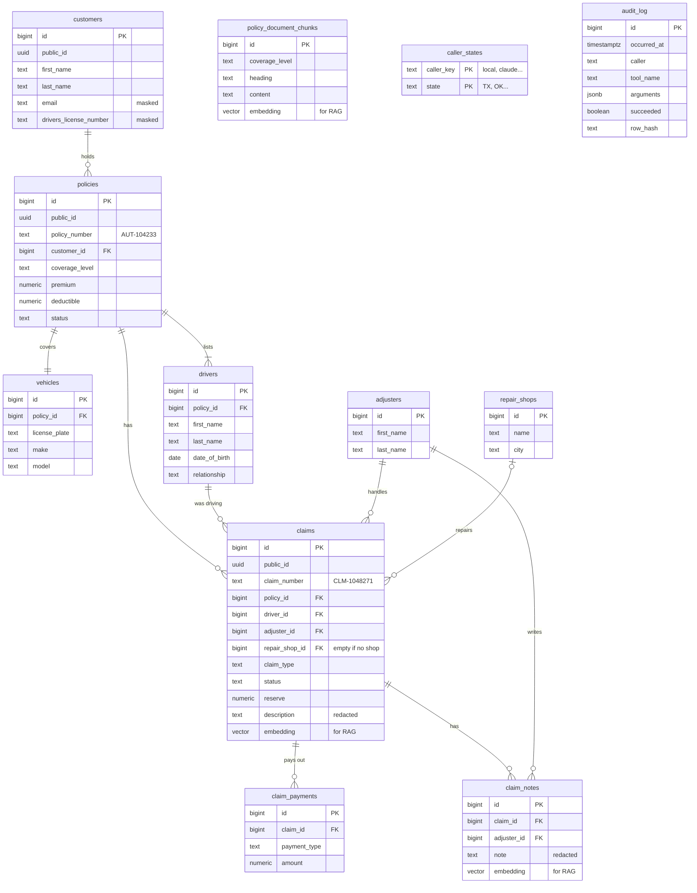

# Appendix B: database security

The MCP server connects to PostgreSQL as a role that can't read a single table. It can only run a fixed set of functions, one per tool, each returning fixed columns with a row limit, and row-level security decides which customers each caller sees. This guide shows how, in the database you built in the quickstart.

Everything here runs against your local Docker database, so you need the quickstart done: the database running (`docker compose ps` says `healthy`) and the data loaded.

## What the setup command did

When you ran `uv run python -m insurance_database.setup_db`, it printed:

```text
Running 010_roles.sql
Running 020_schema.sql
Running 030_permissions.sql
Running 040_helpers.sql
Running 050_audit.sql
Running 060_row_security.sql
Running 070_added_tables.sql
Running 080_mcp_functions.sql
Loaded full data: 12,005 customers, 15,010 policies, 15,090 claims, 76,475 claim notes.
Database ready.
```

In one transaction, so either all of it happens or none of it does, it:

1. Ran the SQL files in [`sql/`](../../sql/) in order: the roles, the tables, the permissions, the functions, the audit log and row-level security.
2. Set the `mcp_reader` password from `READER_DATABASE_URL` in `.env`.
3. Generated the fake data and loaded it.

It drops and rebuilds everything each time, so you can run it again whenever you want to start over.

### The database settings

These are in the `.env` you copied from `.env.example`:

| Setting | What it's for | Read by |
|---|---|---|
| `POSTGRES_PASSWORD` | The password of `postgres`, the admin role in the Docker database | Docker, the first time it creates the database |
| `ADMIN_DATABASE_URL` | How the setup command and the data generator connect: as `postgres`, with full rights | The setup command and the data generator, never the MCP server |
| `READER_DATABASE_URL` | How the MCP server connects: as `mcp_reader`, which can only run the `mcp` functions | The MCP server, and the setup command, which sets this password on `mcp_reader` |

Two things must match. They do in the example, so if you change a password, keep them that way:

- **The password in `ADMIN_DATABASE_URL` is the same as `POSTGRES_PASSWORD`.**
- **The `mcp_reader` password is written only in `READER_DATABASE_URL`.** The setup command takes it from there and sets it on the role, so there's no second copy to keep in step. It must be at least 24 characters.

To make a strong password by hand, this prints 32 random characters:

```bash
uv run python -c "import secrets; print(secrets.token_urlsafe(24))"
```

It only uses letters, digits, `-` and `_`, so the password can go straight into a connection string without any escaping.

**The example passwords are in a public repository, so everyone knows them.** On your own machine that's fine, because the database only listens on `127.0.0.1`. Before you use a database anyone else can reach, replace them. Docker reads `POSTGRES_PASSWORD` only when it first creates the database, so to change it on a database you already have, run `docker compose down -v`, which deletes the database, then the quickstart's step 2 again. The `mcp_reader` password is simpler: change it in `READER_DATABASE_URL` and run the setup command again.

The database only listens on `127.0.0.1`, so other machines on your network can't reach it.

## Look around

Open `psql`, PostgreSQL's command-line client, inside the container as the admin role:

```bash
docker compose exec db psql -U postgres -d insurance
```

Try a few queries:

```sql
select state, count(*) from insurance.customers group by state order by count(*) desc;

select claim_number, claim_type, status, reserve, description
from insurance.claims
order by date_reported desc
limit 5;
```

Type `\q` to leave.

Now connect as `mcp_reader`, the role the MCP server uses, and try to read a table directly:

```bash
docker compose exec db psql -U mcp_reader -d insurance
```

```sql
select * from insurance.claims;         -- ERROR: permission denied for schema insurance
delete from insurance.claims;           -- ERROR: permission denied for schema insurance
select * from mcp.get_dataset_info();   -- works, but every count is 0
```

`mcp_reader` reaches the data only through the functions it's been granted, one by one. To see how each setup script gets it there, read [how mcp_reader is locked down, step by step](./mcp-reader-permissions.md). The decisions behind it are in [database-spec.md](../specs/database-spec.md).

**Why are the counts 0?** Because the database doesn't know who's asking. Each caller sees only the customers in its own states (row-level security), and a caller it doesn't know sees nothing. Tell it you're `local`, the token in your `.env`, which sees every state, and ask again:

```sql
select set_config('mcp.caller_key', 'local', false);
select * from mcp.get_dataset_info();   -- now: 12,005 customers
```

The MCP server does the same before every call, with the name of the token that made the request. [Row-level security, step by step](#row-level-security-step-by-step) below shows the rest.

**Why no password?** Inside the container, the PostgreSQL image trusts connections made on the container itself, so `psql` doesn't ask. Connections from outside the container, like the MCP server's, always need the password.

## The tables

All the tables are in the `insurance` schema. Only the main columns are shown here:



- **Masked** columns are never returned in full: the functions show only part of an email (`m***@example.com`) and the last four characters of a driver's license number.
- **Redacted** text has any phone numbers and email addresses in it replaced with `[phone]` and `[email]` before it's returned. Adjusters sometimes type them into a note. The customer's own street address becomes `[address]`: the database knows whose claim it is, so it can look for that exact address. Names, and any other address, can't be caught this way.
- **`id` never leaves the database.** The tables join on the `bigint` ids, but the functions return `public_id` UUIDs or business numbers (`AUT-…`, `CLM-…`) instead. A sequential id would give away how many rows there are, and let a caller guess other records by counting.
- `policy_document_chunks` holds the three policy booklets, split into sections for RAG ([guide 4](04-rag.md)). It's linked to policies by `coverage_level`, not by a foreign key. The `embedding` columns stay empty until you run the embed command.
- `caller_states` lists which states each caller may see, for row-level security: see [Row-level security, step by step](#row-level-security-step-by-step) below. It's linked to customers by `state`, not by a foreign key.
- `audit_log` isn't linked to the other tables, because it records the tool calls, not the insurance data. Rows can be added but never changed or deleted, and a hash chain makes tampering detectable. [database-spec.md](../specs/database-spec.md) explains how.

## Row-level security, step by step

Each caller sees only the customers in its own states, along with their policies, claims and notes. The quickstart uses one token, `local`, which sees every state. In [appendix A](appendix-a-server-security.md#give-each-client-its-own-token) you give each client its own token, and each of those sees part of the data:

| Caller | States | Sees, but the other two don't |
|---|---|---|
| `local` | All five | |
| `claude` | TX, CO, OK | Oklahoma |
| `copilot` | TX, CO, NM | New Mexico |
| `inspector` | TX, CO, AZ | Arizona |

All three named callers see Texas and Colorado, where the demo customers live (Maria Garcia in Texas, Eleanor Rutherford in Colorado), so the demo questions work with any token.

In this walkthrough you play the part of the MCP server: you tell the database who's calling, then search for a customer.

**Step 1: as the admin, look at the mapping.** Row-level security doesn't filter the admin, so in the `postgres` connection from [Look around](#look-around) you can see every row:

```sql
select caller_key, string_agg(state, ', ' order by state) as states
from insurance.caller_states
group by caller_key
order by caller_key;
```

**Step 2: as `mcp_reader`, search as each caller.** Wendell Pryce lives in Oklahoma, so only `claude` (and `local`) can find them. In the `mcp_reader` connection, run these two lines together:

```sql
select set_config('mcp.caller_key', 'claude', false);
select first_name, last_name, city, state from mcp.find_customers('Wendell Pryce');   -- found
```

Now be `copilot` and search again:

```sql
select set_config('mcp.caller_key', 'copilot', false);
select first_name, last_name, city, state from mcp.find_customers('Wendell Pryce');   -- nothing
```

Try the others too. This is what you should see:

| Search for | `local` | `claude` | `copilot` | `inspector` |
|---|---|---|---|---|
| `Wendell Pryce` (Oklahoma) | Found | Found | Nothing | Nothing |
| `Lucia Benavidez` (New Mexico) | Found | Nothing | Found | Nothing |
| `Trevor Lindqvist` (Arizona) | Found | Nothing | Nothing | Found |
| `Maria Garcia` (Texas) | Found | Found | Found | Found |

- **"Nothing" is an empty result, not an error.** To a caller, a customer it can't see doesn't exist. Ask for one of their claims by number and you get "Unknown claim number", the same as for a number that doesn't exist.
- **A name the database doesn't know sees nothing at all.** Try `select set_config('mcp.caller_key', 'nobody', false);` and `get_dataset_info()` again.
- **How it works:** a policy on each of the seven tables that hold customer data adds a hidden condition to every query, so no function can forget the check. The rule is in [`060_row_security.sql`](../../sql/060_row_security.sql), and [database-spec.md](../specs/database-spec.md) (decision 15) explains it.

**The honest limit:** you just chose your own caller with one line. Anyone with the `mcp_reader` password can do the same, because PostgreSQL has no setting a session can't change. The MCP server sets the caller from the token, and no tool runs raw SQL, so a model can't change it. Keep the `mcp_reader` password as secret as the tokens.

## The audit log

Every tool call is recorded in `insurance.audit_log`. Look at the latest rows as the admin:

```bash
docker compose exec db psql -U postgres -d insurance -c "select occurred_at, caller, tool_name, rows_returned, succeeded from insurance.audit_log order by id desc limit 5"
```

```text
          occurred_at          | caller |    tool_name     | rows_returned | succeeded
-------------------------------+--------+------------------+---------------+-----------
 2026-11-05 22:41:07.512836+00 | local  | get_policy       |             1 | t
 2026-11-05 22:41:05.104420+00 | local  | get_customer     |             1 | t
 2026-11-05 22:41:03.871935+00 | local  | find_customers   |             1 | t
```

The `caller` is the name of the token that made the call. If the server can't write the audit row, it doesn't return the tool's result either: no audit, no answer.

PostgreSQL has no built-in append-only tables, so [`050_audit.sql`](../../sql/050_audit.sql) builds one from three parts:

1. **Only one function can add rows:** `mcp.write_audit`. No role is granted `update` or `delete`.
2. **A trigger blocks `update`, `delete` and `truncate` for everyone,** the admin included.
3. **A hash chain:** each row stores a hash of its own data plus the previous row's hash, so a changed or deleted row breaks the chain.

Try to cover your tracks, as the admin:

```sql
delete from insurance.audit_log;            -- ERROR: The audit log is append-only: DELETE is not allowed.
select insurance.verify_audit_log();        -- null: the whole chain is intact
```

**The honest limit:** the admin can switch the trigger off, change rows and recompute the whole chain. No database can fully protect a log from its own admin. Deleting the newest rows can't be detected either, without a copy of the latest hash kept somewhere else. [database-spec.md](../specs/database-spec.md) has the details.

Requests that never reach a tool, such as ones with a bad token, aren't in the audit log. They're in the server's own log ([appendix A](appendix-a-server-security.md)), because anyone can send a bad token, and the audit log can never be cleaned up.

## The data

All of it is fake. Nothing describes a real person, vehicle or company.

- **The same for everyone.** The generator uses a fixed random seed, so you get exactly the same customers, policies and claims as everyone else, and as these guides. Only the `public_id` UUIDs differ, and nothing relies on them.
- **"Today" is the day you set it up.** The data covers the three years up to the day you ran the setup command, so "last month" means last month. The customers, policies and claims are the same for everyone; only their dates move with the calendar. Run the setup command again to bring the data up to today.
- **Real places, fake people.** Cities, ZIP codes and area codes are real, in Texas, Oklahoma, Colorado, New Mexico and Arizona. Names, street addresses, license plates and driver's license numbers are made up. Every email is at `example.com`, and every phone number is in the `555-0100` to `555-0199` range, which is reserved for fiction.
- **Planted records.** A few records are added on purpose, so the demo questions have good answers: one customer called Rutherford with two policies, Maria Garcia with three claims, one repair shop that's clearly the most expensive. They're all listed at the top of [`planted.py`](../../database/src/insurance_database/generate/planted.py).

It's an insurance claims system kept deliberately small:

| Term | Meaning |
|---|---|
| Policy | The insurance on one vehicle. A customer with two cars has two policies. |
| Premium | What the customer pays for the policy, per year. |
| Deductible | The part of each claim the customer pays themselves. |
| Coverage level | `liability` (damage you cause to others), `liability_collision` (plus damage to your own car in a crash) or `full` (plus theft, fire, vandalism, weather and glass). |
| Claim | A request for the insurer to pay for a loss. |
| Reserve | What the insurer expects a claim to cost in total. |
| Adjuster | The insurer's employee who investigates and settles a claim. |

A few simplifications, so the data stays easy to follow:

- A policy runs from its start date until it's canceled or the data ends. Renewals aren't modeled.
- The policyholder is listed twice: once as a customer and once as a driver on each of their policies.
- Glass claims are windshield claims.
- Real US policies have per-state rules and more kinds of coverage. They're left out.

## Reload the data

The setup command loads the data, so you only need this to reload it:

```bash
uv run python -m insurance_database.generate
```

It empties the tables and loads everything again, in one transaction. It never touches the audit log.

Add `--size small` to either command for about 1/20 of the data, which loads in under a second. The tests use it. The guides and demos assume the full data.

To delete the database completely, including the Docker volume it's stored in, run `docker compose down -v`. Then run the quickstart's step 2 again.

## Run the tests

With Docker running, run the database tests:

```bash
uv run pytest tests/database
```

The tests start their own throwaway PostgreSQL container, build the database from scratch, load the small data, and delete the container at the end. They never touch your database. If Docker isn't running, the database tests are skipped with one message saying so.

A few checks only mean something on the full data, such as "one repair shop is clearly the most expensive". They're skipped by default. To run them:

```bash
uv run pytest -m full_data
```

## Next

[Using this with your own data](06-using-your-own-data.md) explains how to point the same design at a real company's data, and lists the honest limits in one place.
